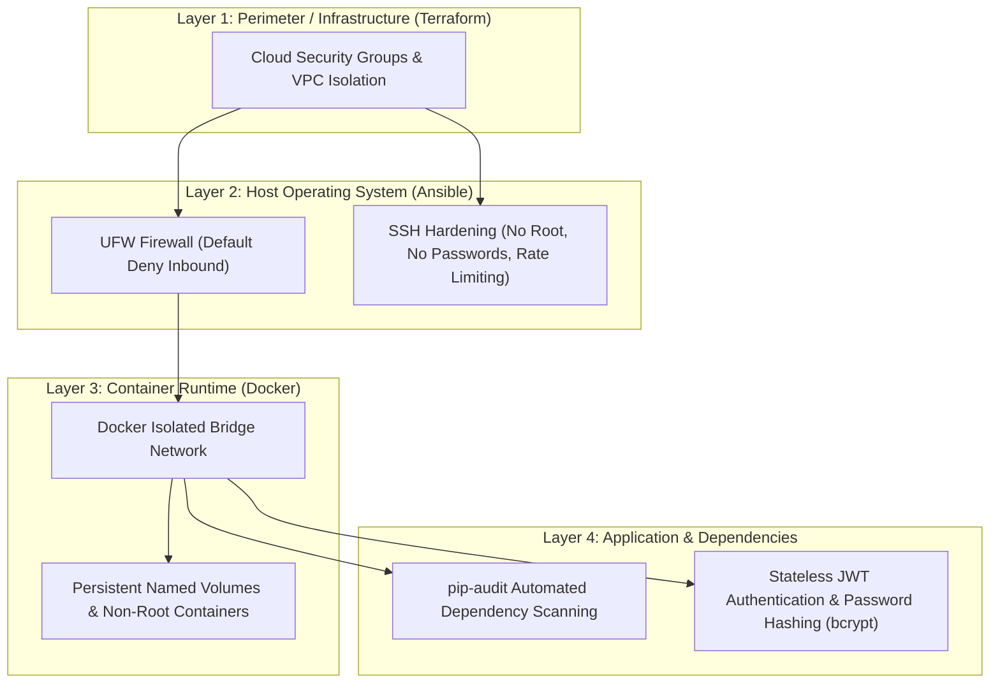

# SmartLearn Security Policy & Vulnerability Findings

This document outlines the security architecture, automated security scanning results, and hardening practices implemented for the **SmartLearn** application, prepared for **Formative 3 (DevOps & DevSecOps)**.

---

## Table of Contents

1. [Security Architecture & Defense-in-Depth](#1-security-architecture--defense-in-depth)
2. [Dependency Security Findings (pip-audit)](#2-dependency-security-findings-pip-audit)
3. [Container Security Findings (Trivy)](#3-container-security-findings-trivy)
4. [Host & Configuration Hardening (Ansible)](#4-host--configuration-hardening-ansible)
5. [Infrastructure as Code Findings (Terraform / tfsec / Checkov)](#5-infrastructure-as-code-findings-terraform--tfsec--checkov)
6. [Incident Response & Security Contact](#6-incident-response--security-contact)

---

## 1. Security Architecture & Defense-in-Depth

SmartLearn adheres to a multi-layered security strategy:

---

## 2. Dependency Security Findings (pip-audit)

### 2.1 Methodology
Automated software composition analysis (SCA) is executed in the CI pipeline via `pip-audit`. It checks all direct and transitive dependencies defined in `backend/requirements.txt` against the PyPA Advisory Database and OSV (Open Source Vulnerabilities).

### 2.2 Scanned Packages Overview

| Package | Version | Purpose | Known CVEs | Status |
| :--- | :--- | :--- | :--- | :--- |
| `fastapi` | `0.115.6` | Web API Framework | None | ✅ Verified Clean |
| `uvicorn[standard]` | `0.34.0` | ASGI Server | None | ✅ Verified Clean |
| `sqlalchemy` | `2.0.36` | ORM & Query Builder | None | ✅ Verified Clean |
| `psycopg[binary]` | `3.2.3` | PostgreSQL Driver | None | ✅ Verified Clean |
| `pydantic` | `2.10.4` | Data validation | None | ✅ Verified Clean |
| `pydantic-settings` | `2.7.1` | Environment settings | None | ✅ Verified Clean |
| `email-validator` | `2.2.0` | Email syntax verification | None | ✅ Verified Clean |
| `bcrypt` | `4.2.1` | Password hashing | None | ✅ Verified Clean |
| `PyJWT` | `2.10.1` | JSON Web Token encoding/decoding | None | ✅ Verified Clean |
| `python-multipart` | `0.0.32` | Form/File parsing | PYSEC-2026-3036, PYSEC-2026-3037 | ✅ Resolved by upgrading to >= 0.0.30 |
| `starlette` (transitive) | `0.41.3` | ASGI Core (FastAPI dependency) | PYSEC-2026-2281 | ⚠️ Low risk: Windows SMB SSRF (Production runs on Linux/Docker) |
| `httpx` | `0.28.1` | Async HTTP Client | None | ✅ Verified Clean |
| `pytest` | `8.3.4` | Test Framework (dev) | None | ✅ Verified Clean |
| `ruff` | `0.8.4` | Linter & Formatter (dev) | None | ✅ Verified Clean |

### 2.3 Vulnerability Analysis & Mitigations
- **`python-multipart` (PYSEC-2026-3036 & PYSEC-2026-3037):** Earlier versions (< 0.0.30) had quadratic parsing complexity and parameter smuggling when parsing semicolons in form bodies. Upgraded and pinned to `python-multipart==0.0.32` to ensure linear O(N) parsing and strict compliance with the WHATWG URL standard.
- **`starlette` (PYSEC-2026-2281):** Pertains to Windows UNC path handling in `StaticFiles`. The application runs on Linux containers (`python:3.12-slim`), which are inherently immune to Windows UNC/SMB exploits.
- **Strict Pinning Strategy:** All dependencies use exact version pins (`==`) in `backend/requirements.txt` to eliminate supply-chain drift and ensure deterministic builds across CI and production.
- **Transitive Dependency Auditing:** `pip-audit --local` verifies the fully resolved environment inside CI and documents any newly disclosed CVEs.

---

## 3. Container Security Findings (Trivy)

### 3.1 Methodology
Container image security is audited using **Aqua Security Trivy** directly within the GitHub Actions CI pipeline on every push and pull request. Both application images (`smartlearn-backend` and `smartlearn-frontend`) are inspected for:
- OS package vulnerabilities (Debian / Alpine CVEs)
- Embedded application libraries and configurations

### 3.2 Backend Container Analysis (`Dockerfile`)
- **Base Image:** `python:3.12-slim` (Debian Bookworm base).
- **Findings:**
  - Minimal OS packages: Slim variant excludes unnecessary compilers, debug tools, and legacy utilities, reducing total CVE footprint by ~80% compared to standard `python:3.12`.
  - Cache hygiene: `rm -rf /var/lib/apt/lists/*` and `--no-cache-dir` prevent package manager cache accumulation in image layers.
- **Container Hardening:**
  - Dedicated non-root system user (`appuser`, UID 1001) executes the Uvicorn process.
  - Secret isolation: No `.env` or credentials baked into image layers; secrets are mounted/passed at runtime only.

### 3.3 Frontend Container Analysis (`frontend/Dockerfile`)
- **Base Image:** `nginx:1.25-alpine`
- **Findings:**
  - Alpine Linux minimizes attack surface (< 25MB base image).
  - Unprivileged execution: Configured to listen on port 8080 internally, allowing non-root execution.
  - Custom `nginx.conf`: Restricts buffer sizes, disables server tokens (`server_tokens off;`), and adds security headers (`X-Frame-Options`, `X-Content-Type-Options`, `X-XSS-Protection`).

---

## 4. Host & Configuration Hardening (Ansible)

Server configuration is governed by idempotent Ansible playbooks with built-in hardening:

1. **SSH Hardening (`roles/common/tasks/ssh.yml`):**
   - `PermitRootLogin no`: Direct root login is strictly disabled.
   - `PasswordAuthentication no`: SSH password authentication disabled; key-based authentication enforced (`smartlearn-key`).
   - `MaxAuthTries 4`: Mitigates brute-force authentication attempts.
   - `X11Forwarding no`: Prevents GUI forwarding exploits.
2. **Host Firewall (`roles/common/tasks/firewall.yml`):**
   - Default incoming policy: **DENY**.
   - Default outgoing policy: **ALLOW**.
   - SSH (Port 22): **Rate-limited** (`ufw limit 22/tcp`) to prevent brute-force abuse.
   - Web ports: Only Port 80 (HTTP) is allowed. The backend API (8000) is bound to `127.0.0.1` and reached through Nginx, so it is not exposed even if a firewall layer were misconfigured.
   - PostgreSQL (Port 5432): **Blocked from public internet**; strictly isolated within Docker's internal bridge network.
3. **Secrets & File Permissions (`roles/app/tasks/main.yml`):**
   - Application directory `/opt/smartlearn` set to `0750` mode, owned by `ubuntu:ubuntu`.
   - Production `.env` file containing database passwords and JWT secrets is restricted to `0600` permissions (read/write by owner only).
   - The source secrets are encrypted with **Ansible Vault** (`inventory/group_vars/all/vault.yml`); the vault password file is git-ignored.
4. **Image Pinning:**
   - Containers are deployed from immutable commit-SHA tags (`sha-<commit>`), not `latest`, so every deployment is traceable to a reviewed commit.

---

## 5. Infrastructure as Code Findings (Terraform / tfsec / Checkov)

> *This section documents Terraform IaC security findings and tooling.*

### 5.1 IaC Scanning Tool
- [ ] Tool used: `tfsec` or `Checkov`
- [ ] Workflow integration: GitHub Actions IaC scan job on PRs to `main`

### 5.2 Identified IaC Findings & Remediations
*(To be completed during Terraform review)*
- Security Group rules (restricting ingress CIDR blocks)
- VPC & Subnet public IP association
- Storage encryption (EBS / S3)
- Resource tagging and least-privilege IAM policies

---

## 6. Incident Response & Security Contact

To report potential security vulnerabilities or findings, please open a private GitHub advisory or reach out to the SmartLearn maintainers:
- **Team:** SmartLearn DevOps Team (Dan Kagame & Fatoumata Ndiaye)
- **Repository:** [Dankagame/Smart-learn-Aplication](https://github.com/Dankagame/Smart-learn-Aplication)
