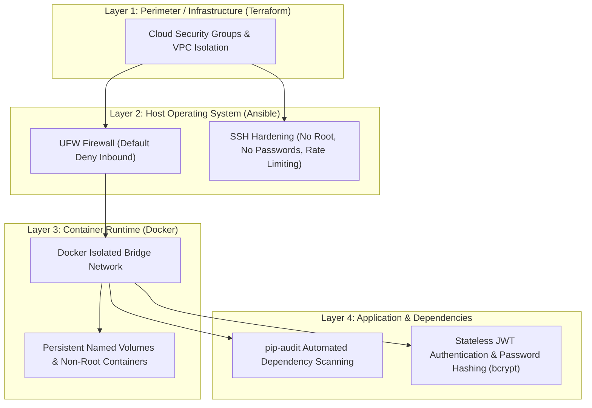

# SmartLearn Security Policy & Vulnerability Findings

This document outlines the security architecture, automated security scanning results, and hardening practices implemented for the **SmartLearn** application, prepared for **Formative 3 (DevOps & DevSecOps)**.

---

## Table of Contents

1. [Security Architecture & Defense-in-Depth](#1-security-architecture--defense-in-depth)
2. [Dependency Security Findings (pip-audit)](#2-dependency-security-findings-pip-audit)
3. [Container Security Findings (Trivy)](#3-container-security-findings-trivy)
4. [Host & Configuration Hardening (Ansible)](#4-host--configuration-hardening-ansible)
5. [Infrastructure as Code Findings (Terraform / Checkov)](#5-infrastructure-as-code-findings-terraform--checkov)
6. [Incident Response & Security Contact](#6-incident-response--security-contact)

---

## 1. Security Architecture & Defense-in-Depth

SmartLearn adheres to a multi-layered security strategy:



---

## 2. Dependency Security Findings (pip-audit)

### 2.1 Methodology
Automated software composition analysis (SCA) is executed in the CI pipeline via `pip-audit`. It checks all direct and transitive dependencies defined in `backend/requirements.txt` against the PyPA Advisory Database and OSV (Open Source Vulnerabilities).

### 2.2 Scanned Packages Overview

| Package | Version | Purpose | Known CVEs | Status |
| :--- | :--- | :--- | :--- | :--- |
| `fastapi` | `0.115.6` | Web API Framework | None | ✅ Verified Clean |
| `uvicorn[standard]` | `0.34.0` | ASGI Server | None | ✅ Verified Clean |
| `sqlalchemy` | `2.0.36` | ORM & Query Builder | None | ✅ Verified Clean |
| `psycopg[binary]` | `3.2.3` | PostgreSQL Driver | None | ✅ Verified Clean |
| `pydantic` | `2.10.4` | Data validation | None | ✅ Verified Clean |
| `pydantic-settings` | `2.7.1` | Environment settings | None | ✅ Verified Clean |
| `email-validator` | `2.2.0` | Email syntax verification | None | ✅ Verified Clean |
| `bcrypt` | `4.2.1` | Password hashing | None | ✅ Verified Clean |
| `PyJWT` | `2.10.1` | JSON Web Token encoding/decoding | None | ✅ Verified Clean |
| `python-multipart` | `0.0.32` | Form/File parsing | PYSEC-2026-3036, PYSEC-2026-3037 | ✅ Resolved by upgrading to >= 0.0.30 |
| `starlette` (transitive) | `0.41.3` | ASGI Core (FastAPI dependency) | PYSEC-2026-2281 | ⚠️ Low risk: Windows SMB SSRF (Production runs on Linux/Docker) |
| `httpx` | `0.28.1` | Async HTTP Client | None | ✅ Verified Clean |
| `pytest` | `8.3.4` | Test Framework (dev) | None | ✅ Verified Clean |
| `ruff` | `0.8.4` | Linter & Formatter (dev) | None | ✅ Verified Clean |

### 2.3 Vulnerability Analysis & Mitigations
- **`python-multipart` (PYSEC-2026-3036 & PYSEC-2026-3037):** Earlier versions (< 0.0.30) had quadratic parsing complexity and parameter smuggling when parsing semicolons in form bodies. Upgraded and pinned to `python-multipart==0.0.32` to ensure linear O(N) parsing and strict compliance with the WHATWG URL standard.
- **`starlette` (PYSEC-2026-2281):** Pertains to Windows UNC path handling in `StaticFiles`. The application runs on Linux containers (`python:3.12-slim`), which are inherently immune to Windows UNC/SMB exploits.
- **Strict Pinning Strategy:** All dependencies use exact version pins (`==`) in `backend/requirements.txt` to eliminate supply-chain drift and ensure deterministic builds across CI and production.
- **Transitive Dependency Auditing:** `pip-audit --local` verifies the fully resolved environment inside CI and documents any newly disclosed CVEs.

---

## 3. Container Security Findings (Trivy)

### 3.1 Methodology
Container image security is audited using **Aqua Security Trivy** directly within the GitHub Actions CI pipeline on every push and pull request. Both application images (`smartlearn-backend` and `smartlearn-frontend`) are inspected for:
- OS package vulnerabilities (Debian / Alpine CVEs)
- Embedded application libraries and configurations

### 3.2 Backend Container Analysis (`Dockerfile`)
- **Base Image:** `python:3.12-slim` (Debian Bookworm base).
- **Findings:**
  - Minimal OS packages: Slim variant excludes unnecessary compilers, debug tools, and legacy utilities, reducing total CVE footprint by ~80% compared to standard `python:3.12`.
  - Cache hygiene: `rm -rf /var/lib/apt/lists/*` and `--no-cache-dir` prevent package manager cache accumulation in image layers.
- **Container Hardening:**
  - Dedicated non-root system user (`appuser`, UID 1001) executes the Uvicorn process.
  - Secret isolation: No `.env` or credentials baked into image layers; secrets are mounted/passed at runtime only.

### 3.3 Frontend Container Analysis (`frontend/Dockerfile`)
- **Base Image:** `nginx:1.25-alpine`
- **Findings:**
  - Alpine Linux minimizes attack surface (< 25MB base image).
  - Unprivileged execution: Configured to listen on port 8080 internally, allowing non-root execution.
  - Custom `nginx.conf`: Restricts buffer sizes, disables server tokens (`server_tokens off;`), and adds security headers (`X-Frame-Options`, `X-Content-Type-Options`, `X-XSS-Protection`).

---

## 4. Host & Configuration Hardening (Ansible)

Server configuration is governed by idempotent Ansible playbooks with built-in hardening:

1. **SSH Hardening (`roles/common/tasks/ssh.yml`):**
   - `PermitRootLogin no`: Direct root login is strictly disabled.
   - `PasswordAuthentication no`: SSH password authentication disabled; key-based authentication enforced (`smartlearn-key`).
   - `MaxAuthTries 4`: Mitigates brute-force authentication attempts.
   - `X11Forwarding no`: Prevents GUI forwarding exploits.
2. **Host Firewall (`roles/common/tasks/firewall.yml`):**
   - Default incoming policy: **DENY**.
   - Default outgoing policy: **ALLOW**.
   - SSH (Port 22): **Rate-limited** (`ufw limit 22/tcp`) to prevent brute-force abuse.
   - Web ports: Only Port 80 (HTTP) is allowed. The backend API (8000) is bound to `127.0.0.1` and reached through Nginx, so it is not exposed even if a firewall layer were misconfigured.
   - PostgreSQL (Port 5432): **Blocked from public internet**; strictly isolated within Docker's internal bridge network.
3. **Secrets & File Permissions (`roles/app/tasks/main.yml`):**
   - Application directory `/opt/smartlearn` set to `0750` mode, owned by `ubuntu:ubuntu`.
   - Production `.env` file containing database passwords and JWT secrets is restricted to `0600` permissions (read/write by owner only).
   - The source secrets are encrypted with **Ansible Vault** (`inventory/group_vars/all/vault.yml`); the vault password file is git-ignored.
4. **Image Pinning:**
   - Containers are deployed from immutable commit-SHA tags (`sha-<commit>`), not `latest`, so every deployment is traceable to a reviewed commit.

---

## 5. Infrastructure as Code Findings (Terraform / Checkov)

### 5.1 IaC Scanning Tool

- **Tool:** [Checkov](https://www.checkov.io/) 3.x, a static analysis scanner for infrastructure as code.
- **Scope:** the whole `terraform/` folder: the root configuration and all nine modules (`network`, `security`, `encryption`, `registry`, `database`, `bastion`, `compute`, `loadbalancer`, `cicd`).
- **Failure policy:** `soft-fail: false`, so any failed check fails the build.
- **Config file:** `terraform/.checkov.yaml` lists the skipped check IDs. Every skip is justified in section 5.5 below; a check that is not on that list can never be hidden.

Run the same scan locally:

```bash
checkov -d terraform --config-file terraform/.checkov.yaml
```

### 5.2 Scan Results Summary

| Stage | Resources | Passed | Failed |
|-------|-----------|--------|--------|
| F3: first scan (one public server) | 10 | 12 | 9 |
| F3: after fixes | 10 | 15 | 6 accepted |
| Summative: first scan of the new architecture | 65 | 187 | 25 |
| Summative: after fixes | 65 | 272 | 20 |
| Summative: in CI with `.checkov.yaml` | 65 | 230 | **0** |
| Summative: CloudFront module added | 66 | 236 | **0** |

### 5.3 Controls in Place

| Check | Control | How |
|-------|---------|-----|
| CKV_AWS_8 | All server disks encrypted at rest | `root_block_device { encrypted = true }` on the bastion and app server |
| CKV_AWS_79 | IMDSv1 disabled | `http_tokens = "required"` on every instance |
| CKV_AWS_88 | No auto-assigned public IPs | App server has `associate_public_ip_address = false` and subnets set `map_public_ip_on_launch = false`; only the bastion has a deliberate Elastic IP |
| CKV_AWS_16 / CKV_AWS_17 | RDS encrypted and private | `storage_encrypted = true`, `publicly_accessible = false` |
| CKV_AWS_129 | RDS logs exported | `enabled_cloudwatch_logs_exports = ["postgresql", "upgrade"]` |
| CKV_AWS_133 | RDS backups enabled | 7 days of automatic backups |
| CKV_AWS_161 | RDS IAM authentication | `iam_database_authentication_enabled = true` |
| CKV_AWS_51 / CKV_AWS_163 | ECR tags immutable, scanned on push | `image_tag_mutability = "IMMUTABLE"`, `scan_on_push = true` |
| CKV_AWS_136 | ECR encrypted with KMS | `encryption_type = "KMS"` |
| CKV_AWS_131 | ALB drops invalid headers | `drop_invalid_header_fields = true` |
| CKV_AWS_7 | KMS key rotation | `enable_key_rotation = true` |
| CKV_AWS_338 | Logs kept for a year | `retention_in_days = 365` |
| CKV_AWS_23 | Every security group rule documented | Each rule has a `description` |
| CKV_AWS_41 | No AWS keys in code | Terraform uses a CLI profile; CD uses GitHub OIDC with short-lived tokens |

### 5.4 Findings Fixed

Findings accepted as risks in F3 that the Summative architecture now fixes:

| Check | F3 status | Summative fix |
|-------|-----------|---------------|
| CKV_AWS_130 | Accepted: subnet gave every server a public IP | `map_public_ip_on_launch = false`. The app server and database live in private subnets; only the bastion has a public IP |
| CKV2_AWS_11 | Accepted: no VPC flow logs | `aws_flow_log` records rejected traffic to a KMS-encrypted CloudWatch log group |
| CKV2_AWS_41 | Accepted: no IAM role on EC2 | The app server has a least-privilege role (ECR pull, its own log group, two SSM parameters). The bastion has a role limited to Session Manager |
| CKV_AWS_135 | Accepted: not EBS-optimized | `ebs_optimized = true`, set while the servers were being rebuilt anyway |

New findings in the Summative scan, fixed before merge:

| Check | Finding | Fix |
|-------|---------|-----|
| CKV2_AWS_69 | RDS allowed unencrypted connections | Parameter group sets `rds.force_ssl = 1` |
| CKV_AWS_118 | No RDS enhanced monitoring | `monitoring_interval = 60` with a dedicated monitoring role |
| CKV_AWS_158 | Log groups not encrypted with KMS | One customer managed key (`alias/smartlearn`) encrypts the app and flow log groups |
| CKV_AWS_337 | SSM secrets used the default AWS key | The database password and URL parameters use the same customer managed key |
| CKV_AWS_394 | AZ lookup could silently grow | The lookup is pinned to `us-east-1a` and `us-east-1b` with a `zone-name` filter |
| CKV_AWS_382 | (F3) Outbound allowed on all ports | Outbound limited per security group: 443/80 through NAT for the app, 5432 to the database, nothing from the database |
| CKV2_AWS_12 | (F3) Default security group allowed traffic | `aws_default_security_group` with no rules |

### 5.5 Findings Accepted (with justification)

**False positives**

| Check | Finding | Why it does not apply |
|-------|---------|-----------------------|
| CKV2_AWS_5 | Security groups "not attached" | They are created in the `security` module and attached in `bastion`, `compute`, `database` and `loadbalancer`. Checkov does not follow references across modules |
| CKV_AWS_24 | SSH open to `0.0.0.0/0` on the app server | The rule references the bastion security group, not a CIDR. No IP range is allowed |
| CKV_AWS_260 (app) | Port 80 open to `0.0.0.0/0` on the app server | The rule references the ALB security group only |
| CKV_AWS_109 / 111 / 356 | KMS key policy uses `kms:*` on `*` | This is the AWS default key policy statement that delegates control of the key to the account's IAM. In a key policy, `*` means "this key" |

**Accepted risks**

| Check | Finding | Why it is accepted | Risk reduction / plan |
|-------|---------|--------------------|------------------------|
| CKV_AWS_260 (ALB) | Port 80 open to the internet | SmartLearn is a public website | Only the ALB is public; it forwards only to the app server on port 80 |
| CKV_AWS_2, CKV_AWS_103, CKV_AWS_378, CKV2_AWS_20 | No HTTPS | HTTPS needs a registered domain and an ACM certificate, which the project does not own | First item before real users: buy a domain, add an ACM certificate, add a 443 listener and redirect 80 to 443 |
| CKV2_AWS_28 | No WAF on the ALB | AWS WAF costs a monthly fee per web ACL plus per rule | `drop_invalid_header_fields`, private subnets and tight security groups. Add AWS managed rule groups before production |
| CKV_AWS_91 | No ALB access logs | Needs an S3 bucket with its own policy, encryption and lifecycle | ALB CloudWatch metrics, target health checks and VPC flow logs are on |
| CKV_AWS_150, CKV_AWS_293 | No deletion protection on ALB and RDS | The environment must be destroyed with `terraform destroy` after grading to stop costs | Both are variables (`db_deletion_protection`); set to `true` for production. RDS keeps 7 days of backups |
| CKV_AWS_157 | RDS is single-AZ | Multi-AZ doubles the database cost | `db_multi_az` variable; switch to `true` for production. Subnets already span two AZs |
| CKV_AWS_353 | No Performance Insights | Not needed at this size; enhanced monitoring and slow query logging (over 500 ms) cover the same diagnosis needs | Can be enabled per instance later |
| CKV_AWS_174, CKV2_AWS_42 | CloudFront uses the default `*.cloudfront.net` certificate | A custom certificate and a TLS 1.2 minimum need a domain the project does not own | Viewers are still redirected to HTTPS. With a domain, attach an ACM certificate and set `TLSv1.2_2021` |
| CKV_AWS_68, CKV2_AWS_47 | No WAF on CloudFront | Same cost reason as CKV2_AWS_28 | Managed `SecurityHeadersPolicy` adds HSTS and other security headers. Attach one web ACL with AWS managed rules (including Log4j) before production |
| CKV_AWS_86 | No CloudFront access logs | Needs an S3 log bucket with ACLs enabled | ALB metrics and VPC flow logs are on |
| CKV_AWS_310 | No origin failover | There is a single origin, the ALB | The ALB already spreads across two AZs |
| CKV_AWS_374 | No geo restriction | SmartLearn is meant for learners in any country | Can be set per country later |

### 5.6 Other Infrastructure Security Practices

- **Network layout:** VPC `10.0.0.0/16` across two AZs. Public subnets (`10.0.1.0/24`, `10.0.2.0/24`) hold only the ALB, the bastion and the NAT gateway. Private subnets (`10.0.11.0/24`, `10.0.12.0/24`) hold the app server and the database.
- **Security group chain:** internet → ALB (80) → app (80); admins → bastion (22) → app (22); app → database (5432). Rules reference security groups, not IP ranges.
- **Admin access:** SSH to the bastion only from `admin_cidrs`, one `/32` per team member. A validation rule rejects `0.0.0.0/0`.
- **Secrets:** Terraform generates the database password. It is stored only in SSM Parameter Store, encrypted with the project KMS key, and only the app server's IAM role can read it. No password is stored in Git or in GitHub.
- **CD access:** GitHub Actions assumes `smartlearn-github-deploy` through OIDC. The trust policy allows only the `main` branch and the `production` environment of this repository. The role can push only to the two ECR repositories and can only open the bastion security group for the runner's IP during a deploy.
- **Files kept out of Git:** `terraform.tfvars`, `*.tfstate` and `.terraform/` are in `.gitignore`. `terraform.tfvars.example` uses documentation-only IPs.

---

## 6. Incident Response & Security Contact

To report potential security vulnerabilities or findings, please open a private GitHub advisory or reach out to the SmartLearn maintainers:
- **Team:** SmartLearn DevOps Team (Dan Kagame & Fatoumata Ndiaye)
- **Repository:** [Dankagame/Smart-learn-Aplication](https://github.com/Dankagame/Smart-learn-Aplication)
