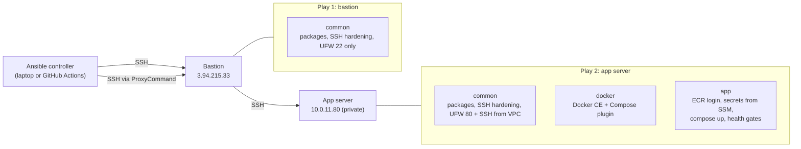

# SmartLearn Configuration and Deployment (Ansible)

This folder configures the servers created by [Terraform](../terraform/README.md) and deploys SmartLearn on them. The same playbook is used for the first setup, for every release from the CD pipeline, and for rollbacks.

**Live app:** http://smartlearn-alb-521972676.us-east-1.elb.amazonaws.com

---

## What the playbook does



| Role | Runs on | Responsibility |
|------|---------|----------------|
| `common` | bastion, app | Baseline packages, UTC time, SSH hardening (`PermitRootLogin no`, `PasswordAuthentication no`, `MaxAuthTries 4`, `X11Forwarding no`), UFW default deny |
| `docker` | app | Official Docker CE repository, Docker Engine, Compose plugin, `ubuntu` user in the `docker` group |
| `app` | app | Pulls the release from ECR, writes `.env` and `docker-compose.yml`, starts the containers and refuses to finish until the app and database are healthy |

### The `app` role, step by step

1. **Require `image_tag`**. Every deployment names an exact image, the git commit SHA.
2. **Install `amazon-ecr-credential-helper`** and point Docker at it. Docker logs in to ECR with the server's IAM role, so there is no registry password anywhere.
3. **Install the AWS CLI** and read `DATABASE_URL` from SSM Parameter Store (`/smartlearn/db/url`, KMS encrypted). The task uses `no_log`, so the value never appears in output.
4. **Template `.env`** (mode `0600`) and **`docker-compose.yml`**.
5. **`docker compose pull`** and **`docker compose up -d`**.
6. **Wait for `/health`** on the backend, then **assert `database == "connected"`**. A release that cannot reach RDS fails the deploy instead of going live.
7. **Wait for the frontend** `/nginx-health`.
8. **Prune images** older than 7 days that no container uses.

The task that matters most for serving traffic is step 6. It turns "containers started" into "the app works end to end".

### Containers on the app server

| Container | Image | Port | Logs |
|-----------|-------|------|------|
| `smartlearn-frontend` | `<ecr>/smartlearn-frontend:<sha>` (nginx) | host `80` → `8080`; proxies `/auth`, `/courses`, `/quizzes`, `/health` to the backend | CloudWatch `/smartlearn/app`, stream `frontend-smartlearn-app` |
| `smartlearn-backend` | `<ecr>/smartlearn-backend:<sha>` (FastAPI) | `127.0.0.1:8000` only | CloudWatch `/smartlearn/app`, stream `backend-smartlearn-app` |

The database is Amazon RDS. There is no database container in production.

---

## Directory structure

```
ansible/
├── ansible.cfg                     defaults, SSH multiplexing, privilege escalation
├── playbook.yml                    play 1: bastion, play 2: app server
├── requirements.yml                community.general, ansible.posix
├── inventory/
│   ├── hosts.ini                   bastion public IP, app private IP, ProxyCommand
│   └── group_vars/
│       ├── all/vars.yml            images, region, SSM parameter, app URL, SSH settings
│       ├── all/vault.yml           encrypted: vault_secret_key (JWT signing key)
│       └── bastion/vars.yml        no app ports, SSH from anywhere (the AWS SG restricts it)
└── roles/
    ├── common/                     system.yml, ssh.yml, firewall.yml
    ├── docker/
    └── app/                        tasks, handlers, templates/{docker-compose.yml.j2, env.j2}
```

---

## Prerequisites

| Requirement | How |
|-------------|-----|
| Ansible core 2.15+ | `pipx install ansible-core` or `brew install ansible` |
| Collections | `ansible-galaxy collection install -r requirements.yml` |
| SSH private key | `~/.ssh/smartlearn-key` (the key Terraform uploaded) |
| Vault password | `ansible/smartlearn.vault.key`, shared privately between team members, never committed |
| Your IP in Terraform | Your `/32` in `admin_cidrs`, otherwise the bastion refuses the connection |
| Images in ECR | `smartlearn-backend:<sha>` and `smartlearn-frontend:<sha>` pushed by the CD pipeline |

---

## Running the playbook

From the `ansible/` folder:

```bash
ansible-galaxy collection install -r requirements.yml

ansible-playbook playbook.yml \
  --vault-password-file smartlearn.vault.key \
  -e image_tag=<git-commit-sha>
```

Useful variations:

```bash
ansible all -m ping --vault-password-file smartlearn.vault.key

ansible-playbook playbook.yml --vault-password-file smartlearn.vault.key -e image_tag=<sha> --check --diff

ansible-playbook playbook.yml --vault-password-file smartlearn.vault.key --tags firewall

ansible-playbook playbook.yml --vault-password-file smartlearn.vault.key -e image_tag=<sha> --tags deploy --limit webservers
```

### Rollback

Every image is kept in ECR under its commit SHA, and tags are immutable. To roll back, run the playbook with the previous SHA:

```bash
aws ecr describe-images --repository-name smartlearn-backend \
  --query 'reverse(sort_by(imageDetails,&imagePushedAt))[:5].imageTags[0]' --output text

ansible-playbook playbook.yml --vault-password-file smartlearn.vault.key -e image_tag=<previous-sha>
```

---

## Idempotency

Running the playbook twice with the same `image_tag` changes nothing:

```
smartlearn-app      : ok=51   changed=0   unreachable=0   failed=0   skipped=1
smartlearn-bastion  : ok=18   changed=0   unreachable=0   failed=0   skipped=2
```

Containers are recreated only when the image tag, `.env` or the compose file changes.

---

## Verifying a deployment

```bash
curl http://smartlearn-alb-521972676.us-east-1.elb.amazonaws.com/health
```

```json
{"status":"ok","database":"connected"}
```

On the app server:

```bash
ssh -i ~/.ssh/smartlearn-key -J ubuntu@3.94.215.33 ubuntu@10.0.11.80
cd /opt/smartlearn
sudo docker compose ps
sudo docker compose logs --tail 50 backend
```

From your laptop:

```bash
aws logs tail /smartlearn/app --follow
```

---

## Security

| Control | Where |
|---------|-------|
| No secrets in Git | `DATABASE_URL` comes from SSM at deploy time; the JWT key is in `vault.yml` (AES-256); `.env` on the server is `0600` |
| No registry password | ECR credential helper with the instance IAM role |
| No public SSH to the app server | AWS SG allows 22 only from the bastion SG; UFW allows 22 only from `10.0.0.0/16` |
| Bastion | AWS SG allows 22 only from `admin_cidrs`; key-only login; UFW opens only 22 |
| SSH hardening | Root login and passwords disabled, `MaxAuthTries 4`, every `sshd_config` edit validated with `sshd -t` before reload |
| Failing deploys stay failed | Health and database assertions stop the run with a non-zero exit code, which fails the CD job |

---

## Troubleshooting

| Symptom | Cause | Fix |
|---------|-------|-----|
| `ssh: connect to host <bastion> port 22: Operation timed out` | Your public IP is not in `admin_cidrs` | Update `terraform/terraform.tfvars`, run `terraform apply` |
| `Connection refused` from the bastion | sshd or UFW on the bastion is blocking you | Connect with AWS Session Manager (`aws ssm start-session --target <bastion-instance-id>`) and check `sudo ufw status` |
| `Connection closed by UNKNOWN port 65535` | The ProxyCommand hop to the bastion failed | Test `ssh ubuntu@<bastion>` on its own first |
| `Pass the image tag to deploy` | `-e image_tag=` missing | Add the commit SHA |
| `manifest unknown` on pull | That SHA was never pushed to ECR | Check with `aws ecr describe-images --repository-name smartlearn-backend` |
| `Backend is up but cannot reach the database` | RDS stopped, wrong `DATABASE_URL`, or security group change | `aws rds describe-db-instances --db-instance-identifier smartlearn-db`, check the DB SG allows the app SG |

### Lesson learned: rate limiting versus automation

The Formative 3 version used `ufw limit` on SSH. Behind a bastion, every Ansible connection arrives from the same IP, so the limit (6 new connections in 30 seconds) rejected Ansible's own connections and the run hung. SSH is now restricted by source instead (security groups plus UFW `from 10.0.0.0/16` on the app server), which is stricter and does not break deployments.
