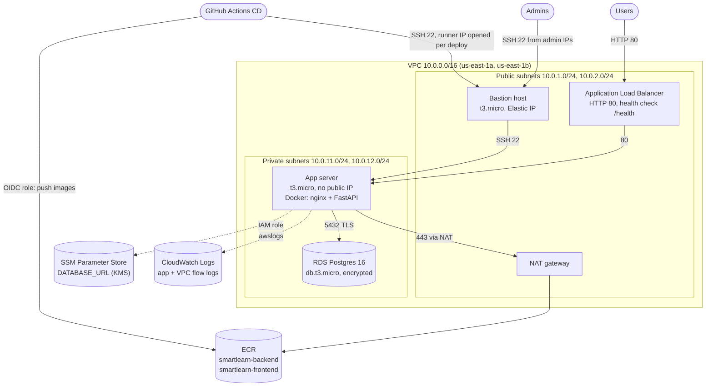

# SmartLearn Infrastructure (Terraform)

This folder builds the full AWS production environment for SmartLearn: a private network across two availability zones, a load balancer, a bastion host, a private app server, a managed Postgres database, a private container registry, and the IAM role the CD pipeline uses.

Ansible (in [`../ansible`](../ansible/README.md)) then configures the servers and deploys the app.

**Live app:** http://smartlearn-alb-521972676.us-east-1.elb.amazonaws.com

---

## Architecture



### Security group chain

| Security group | Inbound | Outbound |
|----------------|---------|----------|
| `smartlearn-alb-sg` | 80 from `0.0.0.0/0` | 80 to the app SG only |
| `smartlearn-bastion-sg` | 22 from `admin_cidrs` only | 22 to the app SG, 80/443 for updates |
| `smartlearn-app-sg` | 80 from the ALB SG, 22 from the bastion SG | 443/80 through NAT, 5432 to the DB SG |
| `smartlearn-db-sg` | 5432 from the app SG | none |

Rules reference other security groups instead of IP ranges, so they keep working when instances are replaced.

---

## Modules

| Module | What it creates | Key decisions |
|--------|-----------------|---------------|
| [`network`](modules/network) | VPC, 2 public + 2 private subnets, internet gateway, NAT gateway, route tables, VPC flow logs | AZs pinned by name; no automatic public IPs; flow logs record rejected traffic |
| [`security`](modules/security) | The four security groups above, one resource per rule | `admin_cidrs` validation rejects `0.0.0.0/0` |
| [`encryption`](modules/encryption) | Customer managed KMS key `alias/smartlearn` | Rotation on; encrypts log groups and SSM secrets |
| [`registry`](modules/registry) | ECR repositories for backend and frontend | Immutable tags, scan on push, KMS, keep newest 20 images |
| [`database`](modules/database) | RDS Postgres 16, subnet group, parameter group, monitoring role, SSM parameters | Private, encrypted, TLS forced, 7-day backups, password generated by Terraform and stored only in SSM |
| [`bastion`](modules/bastion) | Bastion EC2, Elastic IP, Session Manager role | IMDSv2, encrypted disk, static IP |
| [`compute`](modules/compute) | App EC2 in a private subnet, IAM role and instance profile, CloudWatch log group | Role can only pull from ECR, write its own logs and read the two database parameters |
| [`loadbalancer`](modules/loadbalancer) | Internet-facing ALB, target group, HTTP listener | Health check `/health` every 15 s; invalid headers dropped |
| [`cdn`](modules/cdn) | CloudFront distribution in front of the ALB (`enable_cdn`) | HTTPS with the default certificate, redirect HTTP to HTTPS, no caching, security headers |
| [`cicd`](modules/cicd) | GitHub OIDC provider and the `smartlearn-github-deploy` role | Only the `main` branch or `production` environment of this repo can assume it |

Root files:

| File | Purpose |
|------|---------|
| `providers.tf` | Terraform and provider versions; default tags `Project`, `Environment`, `ManagedBy` on every resource |
| `main.tf` | Ubuntu 24.04 AMI lookup, shared SSH key pair, and the module wiring |
| `variables.tf` | Inputs with validation |
| `outputs.tf` | Everything Ansible, the CD pipeline and operators need |
| `.checkov.yaml` | Checkov settings and the justified skip list (see [SECURITY.md §5](../SECURITY.md#5-infrastructure-as-code-findings-terraform--checkov)) |
| `terraform.tfvars.example` | Template for your own `terraform.tfvars` |

---

## Prerequisites

| Tool | Version |
|------|---------|
| Terraform | 1.6 or newer |
| AWS CLI | v2, logged in with an IAM user that can create VPC, EC2, RDS, ECR, IAM, KMS, SSM and CloudWatch resources |
| SSH key pair | `~/.ssh/smartlearn-key` and `~/.ssh/smartlearn-key.pub` |
| Checkov (optional) | 3.x, to run the security scan locally |

Create the SSH key once:

```bash
ssh-keygen -t ed25519 -f ~/.ssh/smartlearn-key -C smartlearn
```

---

## Provision

```bash
cd terraform
cp terraform.tfvars.example terraform.tfvars
```

Edit `terraform.tfvars` and put each admin's public IP:

```hcl
admin_cidrs = ["<your-ip>/32", "<teammate-ip>/32"]
```

Find your IP with `curl https://checkip.amazonaws.com`.

```bash
terraform init
terraform plan -out=tfplan
terraform apply tfplan
```

The first apply takes 10 to 15 minutes, most of it waiting for RDS. When it finishes:

```bash
terraform output
```

| Output | Used for |
|--------|----------|
| `app_url`, `health_url` | The live site and its health check |
| `bastion_public_ip`, `app_private_ip` | Ansible inventory |
| `ssh_bastion`, `ssh_app` | Ready-to-run SSH commands |
| `ecr_registry`, `ecr_repository_urls` | Image pushes and Ansible variables |
| `github_actions_role_arn` | `AWS_ROLE_ARN` secret in GitHub |
| `bastion_security_group_id` | CD opens it briefly for the runner IP |
| `db_endpoint`, `db_url_parameter` | Database host and the SSM parameter holding `DATABASE_URL` |
| `app_log_group` | CloudWatch log group for the containers |
| `target_group_arn` | Checking target health |

Copy `bastion_public_ip` and `app_private_ip` into [`../ansible/inventory/hosts.ini`](../ansible/inventory/hosts.ini), then follow the [Ansible README](../ansible/README.md).

---

## Day-to-day operations

### Check health

```bash
curl "$(terraform output -raw health_url)"

aws elbv2 describe-target-health \
  --target-group-arn "$(terraform output -raw target_group_arn)" \
  --query 'TargetHealthDescriptions[].TargetHealth.State' --output text
```

`{"status":"ok","database":"connected"}` and `healthy` mean users can reach the app and the app can reach the database.

### Read logs

```bash
aws logs tail /smartlearn/app --follow
aws logs tail /smartlearn/vpc-flow-logs --since 1h
```

### SSH to the servers

```bash
eval "$(terraform output -raw ssh_bastion)"
eval "$(terraform output -raw ssh_app)"
```

### Your IP changed

SSH to the bastion times out when your public IP no longer matches `admin_cidrs`. Update `terraform.tfvars` and run `terraform apply`. Only the bastion security group rule changes.

### Security scan

```bash
checkov -d terraform --config-file terraform/.checkov.yaml
```

The current result is 236 passed and 0 failed. Every skipped check is justified in [SECURITY.md §5.5](../SECURITY.md#55-findings-accepted-with-justification).

---

## Cost

Approximate running cost in `us-east-1` is about **$3 per day**. The NAT gateway, the load balancer, RDS, two `t3.micro` instances, public IPv4 addresses and the KMS key make up most of it.

## Tear down

```bash
terraform destroy
```

Deletion protection on RDS and the ALB is off (`db_deletion_protection = false`) so the environment can be removed after grading. ECR repositories are deleted with their images (`force_delete = true`). The KMS key is scheduled for deletion after 7 days.

## Production switches

These are off to keep costs down for the course and are one variable away:

| Variable | Effect |
|----------|--------|
| `db_multi_az = true` | Standby database in the second AZ |
| `db_deletion_protection = true` | `terraform destroy` cannot delete the database |
| `app_instance_type` | Larger app server |
| `availability_zones` | Add a third AZ |

### HTTPS with CloudFront

The [`cdn`](modules/cdn) module puts CloudFront in front of the ALB. It gives an `https://<id>.cloudfront.net` address with a valid certificate and no domain to buy. Viewers are redirected from HTTP to HTTPS, caching is off so every deploy is visible at once, and the managed `SecurityHeadersPolicy` adds HSTS.

It is off by default because new AWS accounts must be verified by AWS Support before they can create CloudFront distributions. Once the account is verified:

```bash
echo 'enable_cdn = true' >> terraform.tfvars
terraform apply
terraform output app_url
```

Then set `app_url` in [`../ansible/inventory/group_vars/all/vars.yml`](../ansible/inventory/group_vars/all/vars.yml) to the new HTTPS URL and run the playbook, so the backend allows it as a CORS origin.

For a custom domain, request an ACM certificate in `us-east-1` and attach it to the distribution.
